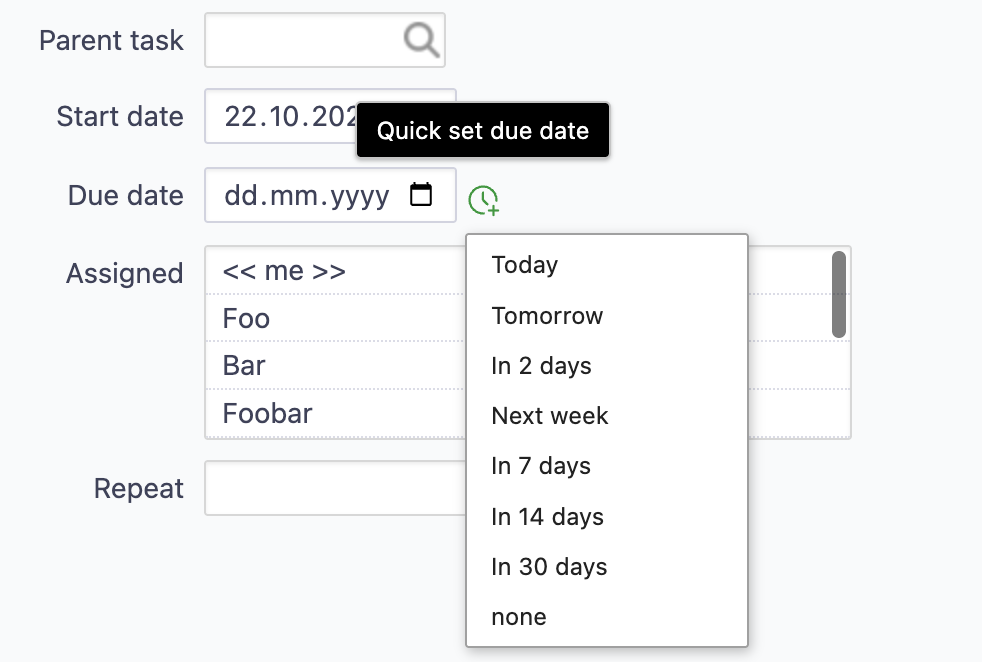

# Redmine Quick Date

A small [Redmine](https://www.redmine.org/) plugin that adds a quick-pick menu to the **Start date** and **Due date** fields of the issue form.

## Introduction

Redmine offers almost everything we need out of the box. We only had to extend it a little for our internal needs, and this plugin was the result.

## Features

A small icon appears next to the *Start date* and *Due date* fields when creating or editing an issue. Hovering over it opens a menu, styled like Redmine's context menu, with these options:

| Option     | Sets the date to                                   |
|------------|----------------------------------------------------|
| Today      | today                                              |
| Tomorrow   | today + 1 day                                      |
| In 2 days  | today + 2 days                                     |
| Next week  | the next Monday that is not a holiday              |
| In 7 days  | today + 7 days                                     |
| In 14 days | today + 14 days                                    |
| In 30 days | today + 30 days                                    |
| none       | clears the field                                   |



- On touch devices, the menu opens with a tap on the icon instead of on hover.
- The icon also works in fields that Redmine reloads while editing, e.g. after changing the tracker or status.
- The menu entries are available in English and German.

The plugin only fills in the form field. The issue is saved as usual with the *Submit* button.

## Requirements

- Redmine 6.0 or higher

## Installation

1. Clone the plugin into the `plugins` directory of your Redmine installation. The directory name must be `redmine_quick_date`, as it has to match the plugin ID:

   ```bash
   cd /path/to/redmine/plugins
   git clone https://github.com/ablida/redmine_quick_date.git
   ```

   Alternatively, download the repository as a ZIP and extract it to `plugins/redmine_quick_date`.

2. In production, publish the plugin assets from your Redmine directory:

   ```bash
   bundle exec rake redmine:plugins:assets_precompile RAILS_ENV=production
   ```

3. Restart Redmine.

No database migrations, permissions or settings are required. More information on installing Redmine plugins: [Redmine Plugins](https://www.redmine.org/projects/redmine/wiki/Plugins).

## Customization

All options are set in `assets/javascripts/quick_date.js`:

- **Menu options:** edit the `optionList()` function.
- **Holidays for "Next week":** *Next week* skips Mondays that are holidays. Holidays are configured in two lists:
  - `fixedHolidays`: specific dates, e.g. `'2026-12-25'`
  - `recurringHolidays`: dates that repeat every year, e.g. `'12-25'`. Preset are the German public holidays with a fixed date (1 Jan, 1 May, 3 Oct, 1 Nov, 24–26 Dec, 31 Dec).

  Holidays can also be provided from elsewhere, e.g. a company calendar, by setting `window.quickDateHolidays = [...]` and/or `window.quickDateRecurringHolidays = [...]` in a script that runs before `quick_date.js`. Both lists are merged with the ones in the file.
- **Translations:** add locale files under `config/locales/` with the same keys as `en.yml`.

## Uninstallation

Remove the `plugins/redmine_quick_date` directory and restart Redmine.

## License

This plugin is licensed under the [GNU General Public License v2.0](LICENSE), unless otherwise stated.

## About

Copyright (c) 2026 ablida
